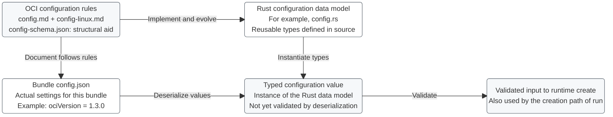
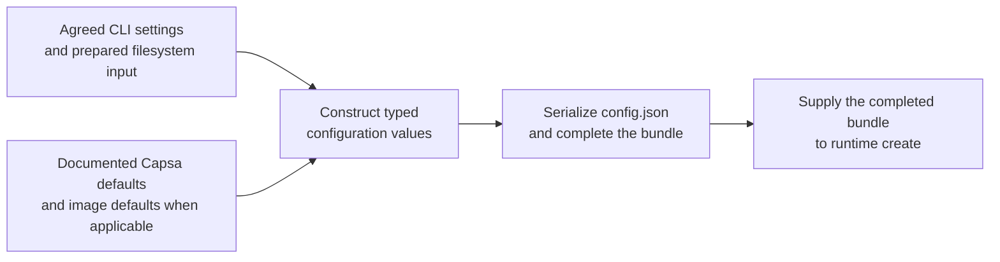

# Capsa configuration mechanics

This is the maintainer reference for configuration representations, input
paths, validation, and their relationship to container creation. The
[CLI API](cli-api.md) defines the public operations and input modes.

Status: the CLI currently parses requests for supplied bundles. Configuration
types, loading, generation, validation, and container execution are not yet
implemented. The diagrams describe the agreed boundary and conceptual data
flow, not existing modules or completed OCI conformance.

## Sources of the configuration model

The reference is OCI Runtime Specification **v1.3.0**:

- [Configuration](https://github.com/opencontainers/runtime-spec/blob/v1.3.0/config.md)
  defines the canonical field requirements and semantics.
- [Linux configuration](https://github.com/opencontainers/runtime-spec/blob/v1.3.0/config-linux.md)
  defines Linux-specific behavior.
- [JSON Schema](https://github.com/opencontainers/runtime-spec/blob/v1.3.0/schema/config-schema.json)
  is a structural aid, with references to other schema files in the same
  version. It does not replace the prose or checks against the actual host.
- [Filesystem bundle](https://github.com/opencontainers/runtime-spec/blob/v1.3.0/bundle.md)
  defines the on-disk input boundary.

Capsa targets Linux workloads, running natively on Linux or in a Linux VM on
macOS and Windows. Native host adapters do not imply separate Windows or macOS
container backends. Host/guest transport and path adaptation remain distinct
from the runtime configuration model; VM hosting does not by itself select
OCI's `vm` configuration platform.

## Big picture

The layout preserves the two levels of the original sketch: reusable
definitions above, and a particular bundle's values flowing into creation
below. Definition arrows describe relationships, not runtime file reads.

The validation arrow covers structural and semantic rules, Capsa support, and
relevant host conditions. Some conditions can only be established during
setup; pre-validation is not proof that creation will succeed.

## Representations and ownership

| Representation | What it contains | Lifetime and role |
| --- | --- | --- |
| OCI specification and JSON Schema | Field definitions, types, relationships, and behavior requirements. | External, versioned reference used while implementing and validating support. |
| Rust configuration types | Structs, enums, and supporting types representing configuration. | Reusable source definitions; `config.rs` is an illustrative module name, not a generated file or a decided implementation layout. |
| Bundle `config.json` | Actual values describing the intended container and process. | On-disk input document; may be supplied by another tool or generated by Capsa. |
| Typed configuration value | One instance of the Rust model, populated from JSON or generated settings. | In-memory data; successful construction or deserialization does not alone establish validity. |
| Validated configuration | Values accepted for the relevant operation and target environment. | Conceptual boundary for runtime setup; the concrete Rust representation is not selected yet. |
| Instance runtime state | Identity, lifecycle status, PID where applicable, and associated runtime bookkeeping. | Changes during the lifecycle; it is separate from the configuration describing the intended environment. |

The Rust model is defined once and evolves with supported behavior. A new
configuration value is populated for each bundle being processed. No Rust
source file is generated per container.

`ociVersion` describes the specification version followed by the bundle. It
is independent of Capsa's package version. For a configuration targeting this
document's baseline, the value is `"1.3.0"`; accepted input versions require an
explicit compatibility policy.
[Specification version](https://github.com/opencontainers/runtime-spec/blob/v1.3.0/config.md#specification-version).

## Supplied bundles

The user selects the existing-bundle input mode. Capsa reads that bundle's
`config.json`, deserializes its values into the runtime's data model, validates
the input, and uses it for creation. The runtime parses the configuration
document, not the JSON Schema document, to obtain container-specific values.

The configuration is authoritative for this instance. Capsa does not silently
replace it with CLI generation defaults, rewrite it, or fall back to generation
because it is missing. A missing configuration in a supplied bundle is an
invalid input, not an instruction to choose another workflow.

The bundle root contains a file named exactly `config.json`. For Linux,
`root.path` identifies an existing filesystem directory and may be absolute
or relative to the bundle. That directory must provide the workload's files;
an empty mountpoint alone does not populate them.
[Bundle](https://github.com/opencontainers/runtime-spec/blob/v1.3.0/bundle.md),
[Root](https://github.com/opencontainers/runtime-spec/blob/v1.3.0/config.md#root).

## Generated bundles

Generation is Capsa's convenience layer before runtime creation:

The generated and supplied paths use the same applicable validation rules.
Constructing values internally does not exempt them from those rules. Invalid
generation input must not proceed to environment setup.

Before adding flags, classify each setting using the CLI's
[bundle-generation input model](cli-api.md#bundle-generation-input-model):
required user input, optional override, or internally managed configuration.
A property required in the resulting document need not be a required flag if
the workflow can derive or default it. Distinguish an OCI-defined default from
a Capsa policy and document their source and precedence.

Image preparation may supply a rootfs and image defaults; it remains a separate
responsibility. Writing runtime JSON neither downloads an image nor populates
the filesystem. Supplied bundles retain their own configuration.

Use structured Rust values and JSON serialization rather than hand-built JSON
strings. Any conversion from native CLI values to JSON strings must be
fallible: do not silently replace non-UTF-8 data. Workload argument ordering and
boundaries must survive the conversion.

### Why serialize if a Rust value already exists?

An OCI bundle requires `config.json` on disk. Generation therefore produces
that artifact even if Capsa already holds equivalent values in memory.

OCI does not prescribe the runtime's Rust function signatures or require an
internal serialize-then-deserialize round trip. The agreed public boundary is
a completed bundle. Internally, Capsa could use the common bundle loader or
reuse validated values corresponding to the written document. That choice
remains open; either approach must preserve the same configuration and
validation contract.

## Loading and validation responsibilities

Deserialization, validation, and execution are distinct responsibilities. A
successful parse must not be presented as proof that requested behavior was
applied. Capsa's configuration boundary accounts for the following layers:

| Layer | Checks and implications |
| --- | --- |
| Bundle and document | Correct layout, readable input, valid JSON, UTF-8 encoding, and no duplicate member names. Duplicate detection must happen before an ordinary object/map conversion could discard that evidence. |
| Structure and types | Required fields and valid data types for the relevant platform and operation. If using a schema validator, resolve its referenced schemas from the same pinned release. The library and integration are not chosen yet. |
| Semantics | Field-specific relationships, units, ranges, path bases, and operation-dependent requirements from the canonical specification. |
| Supported behavior | Distinguish recognized fields with unsupported values from unknown extension properties. Apply the field's required error or warning behavior. |
| Target environment | Check relevant resources and Linux facilities; enforce requirements during setup when they cannot be proven earlier. |

The JSON encoding and duplicate-name rules come from
[OCI JSON requirements](https://github.com/opencontainers/runtime-spec/blob/v1.3.0/glossary.md#json).
Passing the [structural schema](https://github.com/opencontainers/runtime-spec/blob/v1.3.0/schema/config-schema.json)
does not perform all semantic or host checks.

Unknown properties must be ignored, with optional warning; do not blanket-reject
them using a strict deserializer setting. Invalid or unsupported values of
recognized properties follow the applicable rules and exceptions. For example,
ungrantable process capabilities have a warning rule rather than a universal
startup-failure rule. The model and validator must preserve those distinctions.
[Extensibility](https://github.com/opencontainers/runtime-spec/blob/v1.3.0/config.md#extensibility),
[Valid values](https://github.com/opencontainers/runtime-spec/blob/v1.3.0/config.md#valid-values),
[Linux process capabilities](https://github.com/opencontainers/runtime-spec/blob/v1.3.0/config.md#linux-process).

Validation must be operation-aware. `process` is required for `start`; it is
not universally required for `create`. A parsed path is not proof that its
referenced resource exists. Pre-create validation is permitted by OCI;
applying configuration correctly during creation remains mandatory.
[Process](https://github.com/opencontainers/runtime-spec/blob/v1.3.0/config.md#process),
[Create](https://github.com/opencontainers/runtime-spec/blob/v1.3.0/runtime.md#create).

## Consumption and lifecycle

Runtime `create` applies configuration to prepare an instance without executing
the requested workload. `start` executes the prepared process. The creation
path of Capsa's `run` uses the same input boundary; `run` on an existing created
instance uses its frozen configuration and does not replace it from a new
bundle. See the [run lookup contract](cli-api.md#run).

After successful creation, edits to the original configuration must not alter
the instance. How Capsa retains the necessary configuration across separate
invocations is an implementation decision; rereading an edited source file at
start must not change the prepared instance. This freeze does not imply a
filesystem snapshot. State, pause/resume, and other management operations also
depend on runtime state rather than merely a configuration object.
[Lifecycle](https://github.com/opencontainers/runtime-spec/blob/v1.3.0/runtime.md#lifecycle),
[Create and start](https://github.com/opencontainers/runtime-spec/blob/v1.3.0/runtime.md#create).

## Keeping this reference accurate

Update this document with the implementation as it develops. Record concrete
module/type names, supported fields, defaults and precedence, validation and
warning rules, and their observable verification. Keep CLI spelling and help
in the CLI reference, linking here for configuration mechanics.

The following details are intentionally not settled by this document:

- The exposed generation settings, flag spelling, and per-workflow defaults.
- Rust model organization, parsing/serialization libraries, and schema tooling.
- Accepted specification versions and any explicit Capsa extensions.
- Generated bundle location, ownership, overwrite behavior, and failure cleanup.
- Common-loader versus in-memory reuse, configuration retention, and how the
  written document and consumed values are kept consistent.

These are decisions to resolve when implementing their behavior, not evidence
that the corresponding mechanisms already exist.
